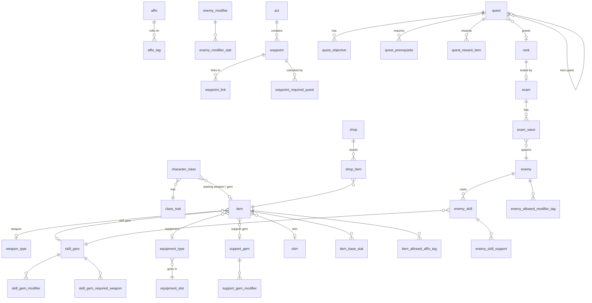
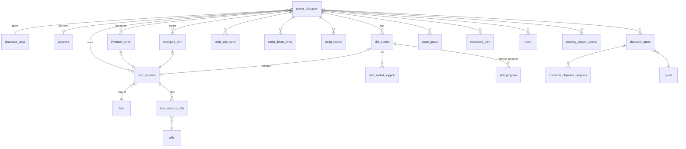

# Database schema

[schema.sql](schema.sql) is a relational model of the game's data (SQLite 3, ~70 tables). It mirrors what the game already stores, so each table maps back to a script:

| Part | Today lives in | Tables |
|---|---|---|
| Lookups | GDScript enums (`StatTypes.Stat`, `TagTypes`, `EquipmentSlots.Slot`, `Ranks.LADDER`) | `stat`, `mod_op`, `tag`, `equipment_slot`, `rarity`, `rank` |
| Game content | `res://data/**/*.tres` | classes, items, affixes, gems, stims, enemies, waypoints, quests, exams, shops, dialogue |
| Player data | `user://saves/slot_N.json` (`SaveManager`, `player.write_save()`) | `player_character` and everything keyed by `character_id` |

Skill-script programs (`SkillProgram.to_dict()`, routine bodies) are kept as JSON columns. They are nested trees (rules, then conditions, effects, loops and branches) that the game always loads and saves whole, so splitting them into rows would add a dozen tables without making any query easier.

## Full ERD

- [erd.png](erd.png) is the whole diagram as one image (all tables, crow's-foot lines).
- [erd.html](erd.html) is the same diagram, interactive: open it in a browser, drag to pan, scroll to zoom, and click a table to highlight its links.
- The sheet is split into 13 area panels. Inside a panel, parent tables are on the left and the tables that reference them on the right. A table that belongs to another area shows up as a dashed stub (just its key), and references to the lookup tables are written as `→ stat`, `→ tag` and so on instead of lines.
- After changing `schema.sql`, rebuild `erd.html` with `python database/build_erd.py` (which tables go in which area is set at the top of that script).

## Content ERD



## Player ERD



## Design notes

- **One item table, one instance table.** `item` is the `ItemDefinition`; `item_kind` plus a CHECK makes sure exactly the matching type column (weapon type, equipment type, gem, stim) is filled. `item_instance` is the `ItemInstance` a character actually holds, with its rarity, level and rolled affixes.
- **Where an instance sits** is a separate row in `inventory_entry`, `equipped_item`, `skill_socket` or `skill_socket_support`. Each of those has a UNIQUE `instance_id`, so the same copy can't be equipped and in the backpack at once. (Moving an item is a delete-and-insert between those tables.)
- **Socketed gems are instances.** The JSON save currently keeps only the gem's definition id for sockets; the schema stores the instance so gems could carry their own level or quality later.
- **Enemy traits** (`data/enemy_traits/*.tres`) are `EnemyModifierDefinition` resources with an on-spawn script, so they share `enemy_modifier` with `is_trait = 1`.
- **Rank** is derived, not stored: `v_character_rank` picks the highest rank whose quest the character has completed (fill `quest.grants_rank_id` from `Ranks.LADDER`).
- **Tags** from four GDScript enums share one `tag` table, split by `tag_family`.

## SQL Server

[schema_sqlserver.sql](schema_sqlserver.sql) is the same schema in T-SQL, generated from `schema.sql` by [export_sqlserver.py](export_sqlserver.py). It creates (or refreshes) a `CodeBreakRequiem` database:

```bash
python database/export_sqlserver.py
sqlcmd -S localhost -E -b -i database/schema_sqlserver.sql
```

Rerunning the load drops and recreates the tables, so any rows typed into them are lost. Differences from the SQLite version: text columns are `NVARCHAR(100)` (or `NVARCHAR(MAX)` for long text and JSON), and five cascading deletes are plain references, because SQL Server allows only one delete path to a table. The generated file lists those five at the top.

To view it in SQL Server Management Studio, connect to `localhost` with Windows Authentication and open Databases > CodeBreakRequiem > Tables. To get SSMS's own diagram, right-click **Database Diagrams** > New Database Diagram and add the tables you want.

## Trying it

```bash
python -c "import sqlite3; c=sqlite3.connect('database/game.db'); c.executescript(open('database/schema.sql').read())"
```

The `stat` and `tag` lookup tables are created empty; fill them from `systems/stats/stat_type.gd` and `systems/Tags/tag_types.gd` (enum order = `enum_value`).
